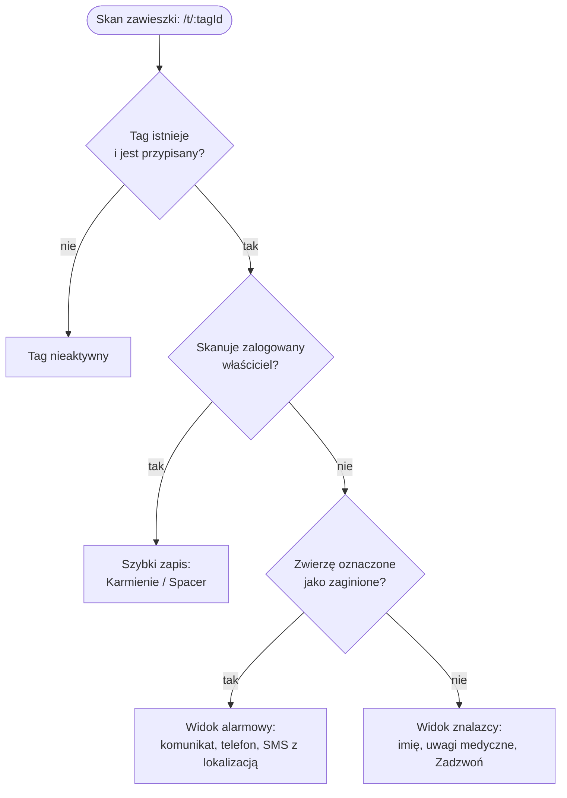
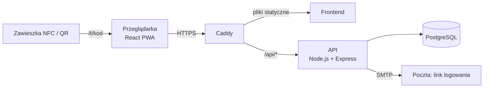

# PeTrace

**System identyfikacji i lokalizacji zwierząt domowych oparty na zawieszkach NFC/QR i aplikacji webowej PWA z routingiem kontekstowym.**

Praca inżynierska · Maciej Strączek · Wyższa Szkoła Turystyki i Ekologii w Suchej Beskidzkiej · 2026/2027

> **Stan:** aplikacja kliencka w budowie na danych przykładowych (etap 1 z 8). Backend zaprojektowany, jeszcze niezaimplementowany.
> Szczegóły w sekcji [Stan prac](#stan-prac).

---

## Spis treści

- [Problem](#problem)
- [Jak to działa](#jak-to-działa)
- [Zakres funkcji](#zakres-funkcji)
- [Architektura](#architektura)
- [Technologie](#technologie)
- [Uruchomienie](#uruchomienie)
- [Struktura repozytorium](#struktura-repozytorium)
- [Trasy](#trasy)
- [Zasady pracy z kodem](#zasady-pracy-z-kodem)
- [Stan prac](#stan-prac)
- [Dokumentacja](#dokumentacja)

---

## Problem

Zagubione zwierzę najczęściej znajduje przypadkowa osoba. Adresówka bywa nieczytelna albo nieaktualna, mikroczip wymaga czytnika, a aplikacje mobilne wymagają od obcej osoby instalacji programu, zanim w ogóle może pomóc.

## Jak to działa

Na zawieszce jest tag NFC i kod QR z unikalnym adresem, np. `petrace.pl/t/K7Q2-M9XD`. Zeskanowanie dowolnym smartfonem otwiera stronę w przeglądarce, **bez instalowania aplikacji**.

Ten sam adres prowadzi do różnych widoków zależnie od tego, kto skanuje i w jakiej sytuacji jest zwierzę. To jest **routing kontekstowy**, a decyzję podejmuje serwer:



Kontrola „właściciel” jest przed „zaginione”, żeby opiekun, który odnalazł swoje zwierzę, nie zobaczył alarmu przeznaczonego dla znalazców. Każdy skan trafia do historii skanowań.

**Prywatność:** poza trybem zaginięcia dane właściciela nie są pokazywane. Lokalizacja znalazcy trafia prosto do SMS-a i nie jest zapisywana w systemie.

## Zakres funkcji

Pełny opis w [`plan/01-zakres.md`](plan/01-zakres.md).

| Priorytet | Funkcja | Stan |
|---|---|---|
| **1 — rdzeń** | Strona zawieszki z czterema wariantami | ⏳ |
| | Wysłanie lokalizacji znalazcy SMS-em (`sms:` z linkiem do mapy) | ⏳ |
| | Tryb zaginięcia z komunikatem dla znalazcy | ⏳ |
| | Logowanie bez hasła (magic link) | 🔄 |
| | Zwierzęta: lista, dodawanie, profil, edycja | 🔄 |
| | Zawieszka: kod, QR do wydruku, adres do zapisu na NFC | ⏳ |
| | Szybki zapis aktywności po skanie | ⏳ |
| | Historia skanowań | ⏳ |
| | PWA: manifest, instalacja, service worker | ⏳ |
| | API + PostgreSQL, wdrożenie Docker na VPS z HTTPS | ⏳ |
| **2** | Link dla weterynarza z datą ważności | ⏳ |
| | Spacery wpisywane ręcznie i podsumowanie z 7 dni | ⏳ |
| | Mapa przy wysyłaniu lokalizacji, zdjęcie zwierzęcia | ⏳ |
| **3** | Harmonogram przypomnień (bez powiadomień) | ⏳ |

✅ gotowe · 🔄 w trakcie · ⏳ zaplanowane

Poza zakresem, opisane w pracy jako kierunki rozwoju: powiadomienia push, śledzenie spaceru przez GPS, mapa zgłoszeń przechowywanych w systemie, lokalizacja skanu z adresu IP.

## Architektura



Całość działa pod jedną domeną, więc nie ma problemów z CORS, a sesja w ciasteczku `httpOnly` działa bez dodatkowej konfiguracji.

### Warstwy aplikacji klienckiej

```
pages  →  components  →  hooks / context  →  api  →  mock (dziś) | fetch /api (docelowo)
```

- **`pages/`**: jedna strona na trasę. Składa komponenty i pobiera dane przez hooki.
- **`components/`**: `layout/` (ramy stron), `ui/` (wspólne klocki), komponenty domenowe (`pets/`, później `finder/`).
- **`hooks/`, `context/`**: `useAsync` (ładowanie, błąd, dane), później `useAuth`.
- **`api/`**: **jedyne miejsce, które wie, skąd przychodzą dane.** Dziś re-eksportuje `api/mock/`, czyli „udawany serwer” na `localStorage` z opóźnieniem 200–500 ms. Po zbudowaniu backendu zmienią się tylko pliki w tym folderze, a strony zostaną bez zmian.

Schemat bazy, lista endpointów i przepływy logowania: [`plan/04-architektura.md`](plan/04-architektura.md).

## Technologie

| Warstwa | Technologia | Stan |
|---|---|---|
| Interfejs | React 19, Vite 8 | ✅ |
| Wygląd | Tailwind CSS v4: tokeny kolorów, fontów i cieni w `@theme` w `src/index.css` | ✅ |
| Nawigacja | React Router v7: zagnieżdżone trasy i layouty | ✅ |
| Ikony i fonty | lucide-react; Bricolage Grotesque i Plus Jakarta Sans przez Fontsource (lokalnie, bez Google Fonts) | ✅ |
| Kod QR, mapa | qrcode.react, Leaflet + OpenStreetMap (P2) | ⏳ |
| PWA | vite-plugin-pwa | ⏳ |
| Serwer | Node.js, Express, SQL bez ORM-a | ⏳ |
| Baza danych | PostgreSQL | ⏳ |
| Wdrożenie | Docker Compose, Caddy (automatyczny HTTPS), VPS | ⏳ |

Uzasadnienia wyborów: [`plan/05-decyzje.md`](plan/05-decyzje.md).

## Uruchomienie

Wymagany Node.js **20.19+** albo **22.12+**.

```bash
cd petracer-final
npm install
npm run dev       # serwer deweloperski: http://localhost:5173
npm run lint      # analiza kodu (ESLint)
npm run build     # wersja produkcyjna do dist/
npm run preview   # podgląd wersji produkcyjnej
```

Przydatne adresy w trybie deweloperskim:

- `/panel`: panel właściciela na danych przykładowych,
- `/dev/ui`: galeria wszystkich komponentów interfejsu.

**Dane przykładowe** są zapisane w `localStorage` pod kluczem `pettrace:db:v1`. Żeby wrócić do stanu początkowego, usuń ten klucz w narzędziach przeglądarki (F12 → Application → Local Storage). Po zmianie kształtu danych w `seed.js` podbij numer wersji w kluczu w `src/mocks/db.js`.

## Struktura repozytorium

```
PeTracker-FinalVersion/
├── plan/                        # dokumentacja: zakres, przypadki użycia, trasy, architektura, decyzje, harmonogram, testy
└── petracer-final/              # aplikacja kliencka (w etapie 4 zmieni nazwę na client/)
    ├── public/                  # pliki statyczne (ikony PWA)
    ├── index.html
    ├── vite.config.js
    └── src/
        ├── main.jsx             # punkt wejścia: fonty, style, RouterProvider
        ├── router.jsx           # definicja wszystkich tras
        ├── index.css            # Tailwind, tokeny (@theme), style bazowe
        ├── pages/               # strony: public/, owner/, dev/
        ├── components/
        │   ├── layout/          # layouty, nawigacja boczna i dolna, nagłówek, logo
        │   ├── ui/              # Button, Card, Badge, Modal, Tabs, Input, Select, Toggle…
        │   └── pets/            # PetCard, PetAvatar
        ├── api/                 # fasada danych: pets.js, auth.js
        │   └── mock/            # „udawany serwer” na localStorage
        ├── mocks/               # seed.js (dane przykładowe), db.js (zapis w localStorage)
        ├── hooks/               # useAsync
        └── lib/                 # czyste funkcje: cn, format, redirect
```

Docelowo dojdą `src/context/` (logowanie), `src/components/finder/` (widoki znalazcy), a obok aplikacji `server/` i `docker-compose.yml`.

## Trasy

| Adres | Strona | Layout | Logowanie | Stan |
|---|---|---|---|---|
| `/` | strona główna | Public | — | ✅ |
| `/login` | formularz e-mail | Public | — | 🔄 |
| `/auth/verify` | weryfikacja linku z e-maila | Public | — | ⏳ |
| `/t/:tagId` | strona zawieszki (routing kontekstowy) | Finder | — | ⏳ |
| `/t/:tagId/lokalizacja` | wysłanie lokalizacji SMS-em | Finder | — | ⏳ |
| `/t/:tagId/wyslano` | potwierdzenie | Finder | — | ⏳ |
| `/vet/:shareToken` | paszport medyczny (P2) | Vet | — | ⏳ |
| `/panel` | lista zwierząt i ostatnie skanowania | Owner | tak | 🔄 |
| `/zwierzeta/nowe` | nowe zwierzę | Owner | tak | ⏳ |
| `/zwierzeta/:id` | profil: dane, zdrowie, aktywność | Owner | tak | ⏳ |
| `/zwierzeta/:id/edytuj` | edycja | Owner | tak | ⏳ |
| `/zwierzeta/:id/zaginiecie` | tryb zaginięcia | Owner | tak | ⏳ |
| `/zwierzeta/:id/tag` | zawieszka, QR, historia skanowań | Owner | tak | ⏳ |
| `/zwierzeta/:id/vet-share` | link dla weterynarza (P2) | Owner | tak | ⏳ |
| `/spacery`, `/spacery/nowy`, `/spacery/:id` | spacery (P2) | Owner | tak | ⏳ |
| `/harmonogram` | przypomnienia (P3) | Owner | tak | ⏳ |
| `/ustawienia` | imię, telefon dla znalazców, wylogowanie | Owner | tak | ⏳ |
| `/dev/ui` | galeria komponentów | Public | — | ✅ |
| `*` | 404 | Public | — | ✅ |

Ochrona tras panelu (`RequireAuth`) powstaje w etapie 1. Opis widoków: [`plan/03-widoki-i-trasy.md`](plan/03-widoki-i-trasy.md).

## Zasady pracy z kodem

- Strony i komponenty **nie importują** niczego z `mocks/` ani `api/mock/`, tylko z `api/*.js`.
- Kolory, fonty i cienie wyłącznie z tokenów (`bg-pine`, `text-ink-muted`, `shadow-card`…), bez wartości na sztywno.
- Każda strona z danymi obsługuje trzy stany: ładowanie, błąd i brak danych.
- Interfejs mobile-first, duże przyciski, obsługa klawiatury i atrybuty `aria-*`.

**Definicja ukończenia funkcji** ([`plan/06-harmonogram.md`](plan/06-harmonogram.md)):

1. działa w przeglądarce bez błędów w konsoli,
2. `npm run lint` i `npm run build` przechodzą,
3. działa na telefonie i na komputerze,
4. obsługuje ładowanie, błąd i brak danych,
5. README albo dokumentacja jest zaktualizowana, jeśli zmienia się struktura lub trasy,
6. trafia do repozytorium osobnym commitem z opisem zmiany.

## Stan prac

| Kamień milowy | Termin | Stan |
|---|---|---|
| M1 Logowanie i dane działają | 8.11.2026 | 🔄 |
| M2 Panel właściciela | 22.11.2026 | ⏳ |
| M3 Rdzeń aplikacji klienckiej (strona zawieszki) | 6.12.2026 | ⏳ |
| M4 Aplikacja dostępna online jako PWA | 13.12.2026 | ⏳ |
| M5 API gotowe | 3.01.2027 | ⏳ |
| M6 System zintegrowany | 10.01.2027 | ⏳ |
| M7 Praca gotowa do złożenia | 24.01.2027 | ⏳ |

**Zrobione:** konfiguracja projektu i tokenów, mapa tras, 5 layoutów z nawigacją, komplet komponentów UI, dane przykładowe i baza w `localStorage`, `useAsync`, lista zwierząt w panelu.
**Teraz:** logowanie magic link na danych przykładowych, kontekst `useAuth`, ochrona tras.

Lista zadań: [`plan/06-harmonogram.md`](plan/06-harmonogram.md).

## Dokumentacja

| Plik | Zawartość |
|---|---|
| [`00-start.md`](plan/00-start.md) | przegląd projektu |
| [`01-zakres.md`](plan/01-zakres.md) | zakres funkcjonalny i priorytety |
| [`02-przypadki-uzycia.md`](plan/02-przypadki-uzycia.md) | aktorzy i scenariusze |
| [`03-widoki-i-trasy.md`](plan/03-widoki-i-trasy.md) | podstrony i adresy |
| [`04-architektura.md`](plan/04-architektura.md) | architektura, baza danych, API, wdrożenie |
| [`05-decyzje.md`](plan/05-decyzje.md) | dziennik decyzji projektowych |
| [`06-harmonogram.md`](plan/06-harmonogram.md) | harmonogram, kamienie milowe, ryzyka |
| [`07-praca-pisemna.md`](plan/07-praca-pisemna.md) | konspekt pracy dyplomowej |
| [`08-ankieta.md`](plan/08-ankieta.md) | badanie ankietowe |
| [`09-testy.md`](plan/09-testy.md) | scenariusze testów na urządzeniach |

## Autor

Maciej Strączek — praca inżynierska, kierunek informatyka.
